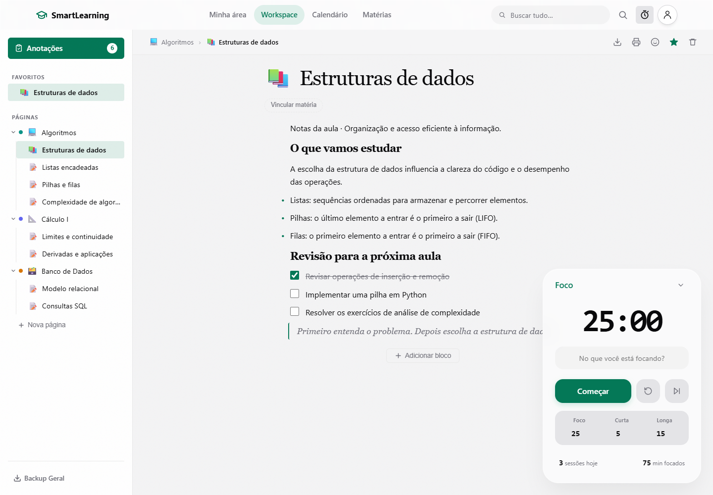
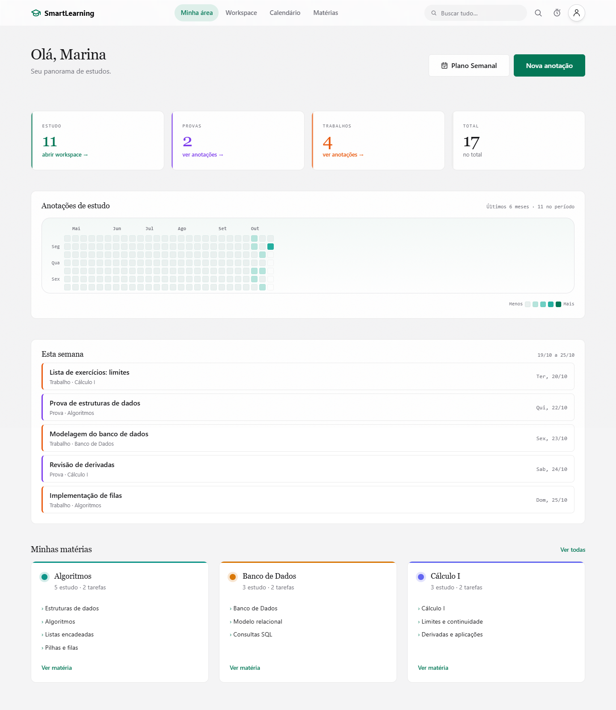
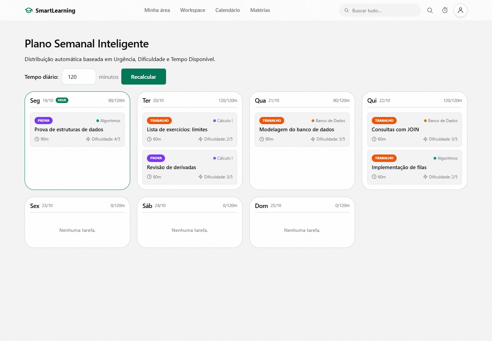
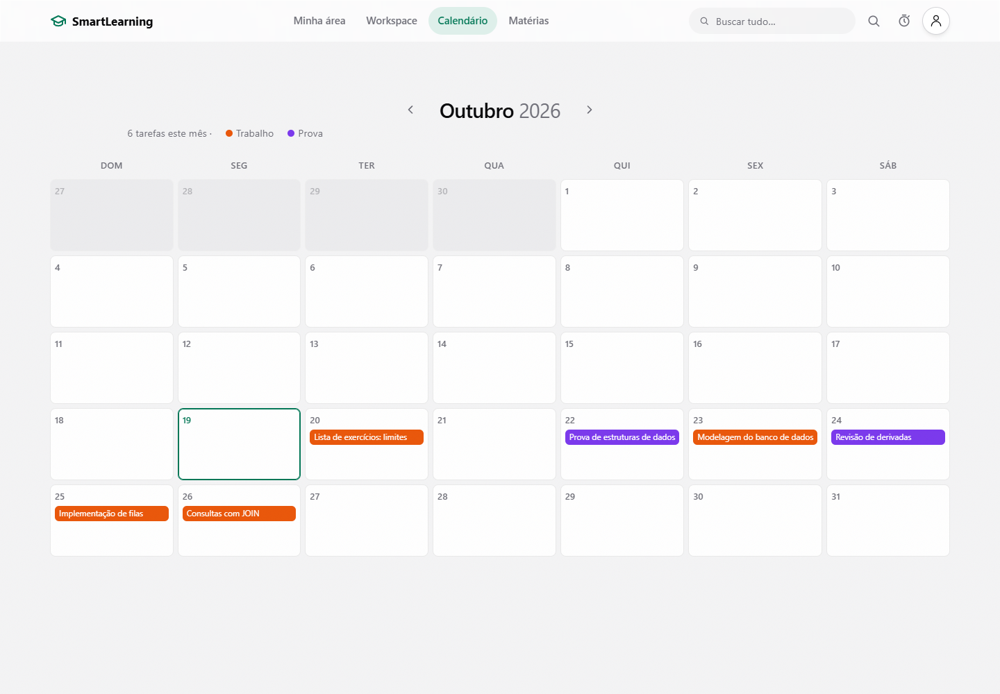

# SmartLearning

O SmartLearning começou com uma ideia simples. Quero abrir a matéria, ver quando é a próxima prova e continuar a anotação da última aula no mesmo lugar. Uma página do workspace pode ficar vinculada a uma matéria, e as sessões do Pomodoro ficam registradas na página que eu estava estudando.

O Django renderiza as páginas e atende as chamadas da interface. No workspace, o JavaScript troca o conteúdo ao navegar entre anotações e salva os blocos conforme são editados. A interface usa HTML, CSS e APIs do navegador, sem etapa de build no front-end.

## Demonstração da interface

Capturas da aplicação em execução, com dados fictícios para demonstração.

### Workspace e Pomodoro

Na captura, a página de Estruturas de Dados reúne notas e uma lista de exercícios. Os blocos podem ser reordenados por arraste. No Pomodoro, dá para ajustar a duração do foco e das pausas e conferir quantas sessões e minutos de foco foram registrados no dia.



### Minha área

Na Minha área, dá para ver o que vence na semana. O mapa de atividade mostra em quais dias foram registradas anotações de estudo.



### Planejador semanal

Você informa quantos minutos tem por dia, e o planejador distribui provas e trabalhos pendentes pelos próximos sete dias. Ele prioriza o que está mais perto do prazo e tem maior dificuldade, usando a duração estimada para encaixar cada tarefa. Se uma tarefa não couber no tempo disponível, ela ainda pode entrar no dia menos ocupado até a data de vencimento.



### Calendário acadêmico

O calendário mostra os prazos do mês. Ao clicar em uma prova ou trabalho, dá para abrir a anotação correspondente.



## Busca e exportação

A busca global encontra termos em páginas, blocos, anotações e matérias. Os resultados mostram o trecho onde o termo aparece e também podem ser consultados em JSON com `?format=json`. Dá para exportar uma página em Markdown ou baixar em JSON os textos e a estrutura dos blocos.

## Stack técnica

| Camada | Tecnologias |
|--------|-------------|
| Back-end | Python 3.14 (local) / 3.13 (Render), Django 6.0.5, SQLite (dev) / PostgreSQL (prod) |
| Front-end | HTML5, Vanilla JS, Vanilla CSS |
| Segurança | CSRF, X-Frame-Options, validação de upload e proteção contra open redirect |
| Testes | 50 testes cobrindo views, APIs, isolamento por usuário e XSS |

## Rodando localmente

```bash
git clone https://github.com/Fernandoszmaclin/SmartLearning.git
cd SmartLearning

python -m venv .venv
# Windows:
.venv\Scripts\activate
# Linux/macOS:
source .venv/bin/activate

cd SmartLearning  # pasta que contém manage.py e requirements.txt
pip install -r requirements.txt

cp .env.example .env   # edite as variáveis conforme necessário

python manage.py migrate
python manage.py createsuperuser
python manage.py runserver
```

Acesse `http://127.0.0.1:8000/`.

Para usar SQLite localmente, remova a linha `DATABASE_URL=` do `.env` antes de executar as migrações.

### Variáveis de ambiente (`.env`)

| Variável | Padrão (dev) | Descrição |
|----------|-------------|-----------|
| `DJANGO_SECRET_KEY` | chave fixa de desenvolvimento | Configure uma chave secreta própria; obrigatória em produção |
| `DJANGO_DEBUG` | `True` | Defina `False` em produção |
| `DJANGO_ALLOWED_HOSTS` | `*` se vazio em dev | Hosts permitidos, separados por vírgula; restrinja em produção |
| `DATABASE_URL` | SQLite se a variável estiver ausente | URL de conexão para PostgreSQL; remova a linha vazia para usar SQLite |

### Rodando os testes

Na pasta que contém `manage.py`, gere os arquivos estáticos exigidos pelo WhiteNoise antes de rodar a suíte:

```bash
python manage.py collectstatic --noinput
python manage.py test
```
