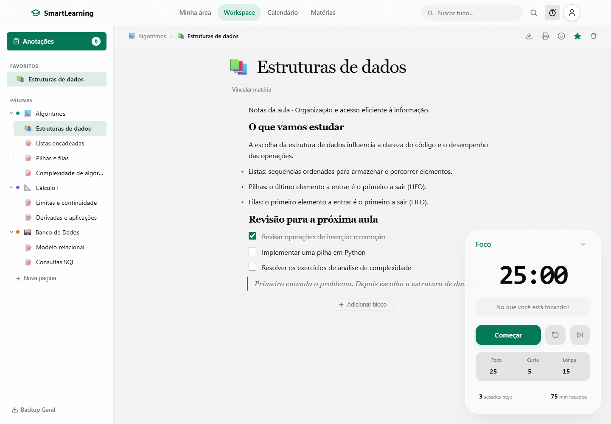
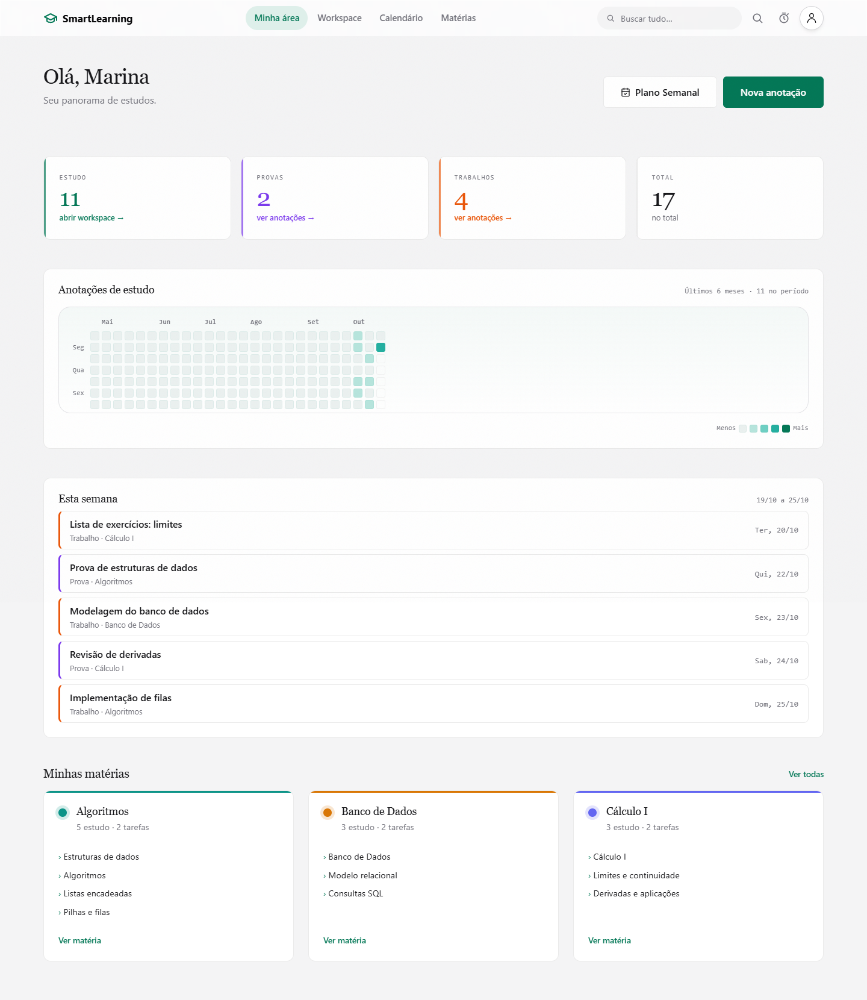
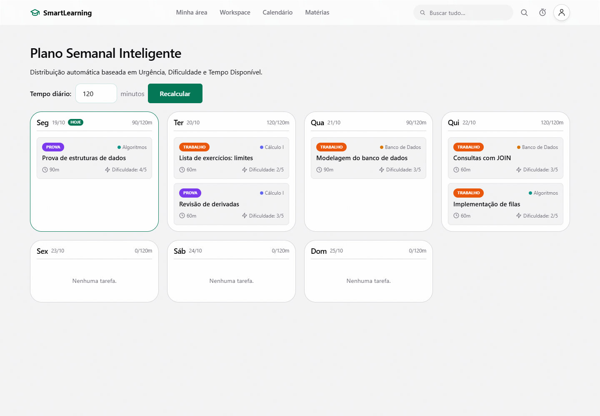
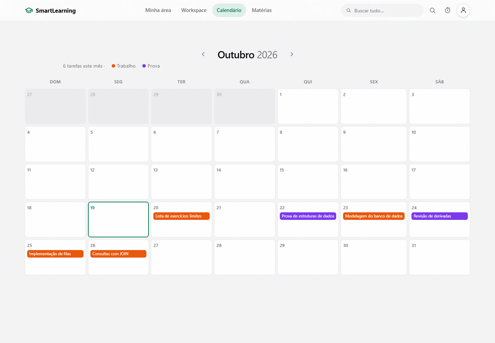

<h1 align="center">SmartLearning</h1>

<p align="center">
  Ambiente unificado de estudos com workspace estilo Notion, timer Pomodoro integrado, gestão acadêmica e planejador semanal. Construído com Django e Vanilla JS/CSS, sem framework de frontend.
</p>

<p align="center">
  
  
  
  
</p>

## Sobre o projeto

O SmartLearning nasceu da vontade de juntar toda a rotina acadêmica em um lugar só: editor de notas, controle de prazos, timer de foco e um panorama do progresso, sem precisar pular entre três apps diferentes.

A ideia foi manter a stack enxuta. Django cuida do back-end e o front é feito em Vanilla JS/CSS, sem bundler nem biblioteca de componentes. Toda a parte interativa (navegação SPA, drag & drop, editor de blocos) foi construída em cima das APIs nativas do browser.

## Demonstração da interface

Capturas da aplicação em execução, com dados fictícios para demonstração.

### Workspace e Pomodoro

Páginas organizadas por matéria, editor de blocos e timer de foco integrado.



### Minha área

Resumo de estudos, provas e trabalhos, mapa de atividade e próximos prazos.



### Planejador semanal

Distribuição das tarefas de acordo com os prazos, a dificuldade e o tempo disponível por dia.



### Calendário acadêmico

Visão mensal dos prazos, com identificação de trabalhos e provas.



## Funcionalidades

### Workspace (editor estilo Notion)

- Editor de blocos com texto, listas, tarefas, código e arquivos; reordenação por arrastar e soltar com salvamento automático.
- Páginas e pastas aninhadas, favoritos, emojis e vínculo com matérias; navegação sem recarregar.
- Exportação de páginas em Markdown e de textos e estrutura dos blocos em JSON.

### Hub Acadêmico

- Gestão de matérias e de trabalhos e provas por matéria, com professor, prazo, dificuldade, tempo estimado e status.
- Calendário de prazos e planejamento semanal automático por urgência, dificuldade e disponibilidade diária.
- Dashboard com resumo acadêmico e mapa de atividade dos estudos.

### Pomodoro

- Foco e pausas curtas ou longas com duração configurável.
- Sessões vinculadas à página em estudo, com total diário de sessões e minutos de foco.

### Busca global

- Pesquisa em páginas, blocos, anotações e matérias, com trechos destacados e resposta JSON para integrações (`?format=json`).

## Stack técnica

| Camada | Tecnologias |
|--------|-------------|
| Back-end | Python 3.14 (local) / 3.13 (Render), Django 6.0.5, SQLite (dev) / PostgreSQL (prod) |
| Front-end | HTML5, Vanilla JS, Vanilla CSS |
| Segurança | CSRF, X-Frame-Options, validação de upload e proteção contra open redirect |
| Testes | 50 testes cobrindo views, APIs, isolamento por usuário e XSS |

## Rodando localmente

```bash
git clone https://github.com/Fernandoszmaclin/SmartLearning.git
cd SmartLearning

python -m venv .venv
# Windows:
.venv\Scripts\activate
# Linux/macOS:
source .venv/bin/activate

cd SmartLearning  # pasta que contém manage.py e requirements.txt
pip install -r requirements.txt

cp .env.example .env   # edite as variáveis conforme necessário

python manage.py migrate
python manage.py createsuperuser
python manage.py runserver
```

Acesse `http://127.0.0.1:8000/`.

Para usar SQLite localmente, remova a linha `DATABASE_URL=` do `.env` antes de executar as migrações.

### Variáveis de ambiente (`.env`)

| Variável | Padrão (dev) | Descrição |
|----------|-------------|-----------|
| `DJANGO_SECRET_KEY` | chave fixa de desenvolvimento | Configure uma chave secreta própria; obrigatória em produção |
| `DJANGO_DEBUG` | `True` | Defina `False` em produção |
| `DJANGO_ALLOWED_HOSTS` | `*` se vazio em dev | Hosts permitidos, separados por vírgula; restrinja em produção |
| `DATABASE_URL` | SQLite se a variável estiver ausente | URL de conexão para PostgreSQL; remova a linha vazia para usar SQLite |

### Rodando os testes

Na pasta que contém `manage.py`, gere os arquivos estáticos exigidos pelo WhiteNoise antes de rodar a suíte:

```bash
python manage.py collectstatic --noinput
python manage.py test
```
